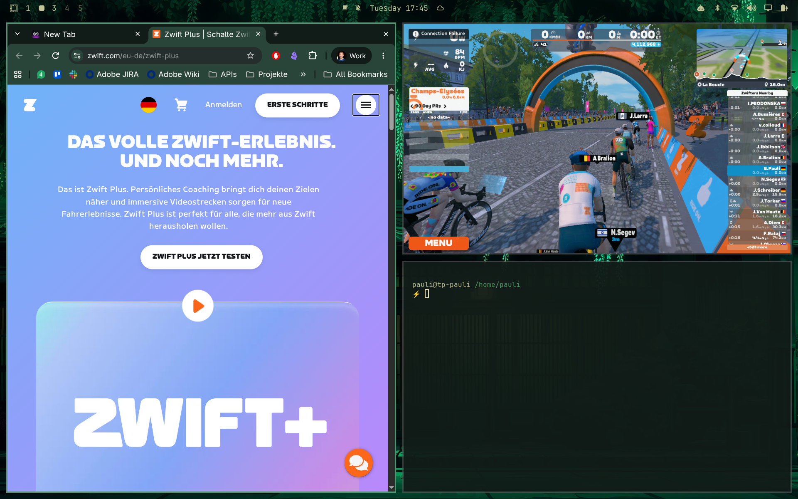

# zwift-bootstrap

A native Linux replacement for the Zwift Windows launcher. The binary `zwift-bootstrap` installs and updates the Zwift game files directly from the Zwift CDN. Then it starts `ZwiftApp.exe` with Wine. You do not need the Windows launcher, .NET or WebView2 in your Wine prefix.



This is an unofficial project. It is not made, supported or approved by Zwift, Inc. "Zwift" is a trademark of Zwift, Inc. Zwift can change its update format at any time, and then this tool stops working until it is updated. You need your own Zwift account.

## What it does

- **Install and update.** Reads the current game version from the Zwift CDN, downloads only the files that changed, and checks the length and CRC-32 of every file. The install directory changes only after all files have passed. An interrupted run continues on the next run.
- **Start the game.** Runs `ZwiftApp.exe` through Wine from the install directory. The game shows its own login screen.
- **Check the files.** `verify` compares every installed file with the manifest.

## Requirements

- Linux on x86_64.
- Wine. wine-staging 11 works.
- BlueZ, for Bluetooth LE sensors.

## Install

On Arch Linux, install the package from the AUR:

```sh
yay -S zwift-bootstrap-bin
```

The package also installs `zwift-start` and the desktop entry.

On Debian 12 or later and Ubuntu 22.04 or later, add the APT repository and install the package:

```sh
curl -fsSL https://bpauli.de/apt-packages/key.gpg | sudo tee /usr/share/keyrings/bpauli-apt.gpg > /dev/null
echo "deb [signed-by=/usr/share/keyrings/bpauli-apt.gpg] https://bpauli.de/apt-packages stable main" | sudo tee /etc/apt/sources.list.d/bpauli.list
sudo apt update
sudo apt install zwift-bootstrap
```

Each release also has the `.deb` file and the binary as a `.tar.gz` file on its GitHub release page. The binary needs the D-Bus library (`libdbus-1`), which most desktops already have.

To build from source, see [docs/building.md](docs/building.md).

## Usage

```sh
zwift-bootstrap check      # local and server version, size of the next update
zwift-bootstrap install    # first install, about 4.8 GiB
zwift-bootstrap update     # bring an install to the server version
zwift-bootstrap verify     # check all files, exit 1 on a problem
zwift-bootstrap launch     # start the game with Wine
```

Options:

- `--dir DIR` sets the install directory. The default is `$XDG_DATA_HOME/zwift` (`~/.local/share/zwift`).
- `--jobs N` sets the number of parallel downloads for `install` and `update`. The default is 8.
- `WINE` sets the Wine command for `launch`. The default is `wine`.
- `WINEPREFIX` sets the Wine prefix for `launch`. The default is `$XDG_DATA_HOME/zwift-wine`.
- Arguments after `--` go to the game, for example `zwift-bootstrap launch -- --some-flag`.

Downloads are staged in `$XDG_CACHE_HOME/zwift/downloads` (`~/.cache/zwift/downloads`).

## Set up Wine

1. Install Wine. On Arch Linux: `pacman -S wine-staging`.
2. Create the prefix and set Windows 10:

   ```sh
   export WINEPREFIX=~/.local/share/zwift-wine
   wineboot -i
   wine winecfg -v win10
   ```

3. Start the game with `zwift-bootstrap launch`.

The game writes its logs and settings to `Documents/Zwift` in the prefix. Wine usually links that folder to `~/Documents`, so look in `~/Documents/Zwift`.

## Desktop entry

`contrib/zwift-start` updates the game and then starts it. `contrib/zwift.desktop` adds Zwift to your application menu.

```sh
install -m755 contrib/zwift-start ~/.local/bin/zwift-start
install -m644 contrib/zwift.desktop ~/.local/share/applications/zwift.desktop
```

The desktop entry uses a generic icon. You can set `Icon=` to an image of your choice.

## Graphics tips

- **Laptop battery saver.** On battery, Zwift limits the frame rate to about 20 FPS. Switch off the battery saver in the Zwift settings, or connect the charger.
- **Unknown GPU.** When Zwift does not know your GPU, it uses its basic profile at 1024x576. To force better settings, copy one of the profiles over the basic profile in the install directory:

  ```sh
  cd ~/.local/share/zwift/data/configs
  cp basic.txt basic.txt.orig
  cp ultra.txt basic.txt    # or high.txt or medium.txt
  ```

  After this change, `verify` reports `basic.txt` as changed. A game update can restore the original file.

## Video routes

With the default Wine settings, Zwift shows a technical error when you select **Video** in the route list. Zwift needs H.264 video decoding through Direct3D 11, and Wine supplies this only with its Vulkan renderer.

1. Install a 64-bit Vulkan driver for your GPU and the GStreamer H.264 plugins. On Arch Linux: `pacman -S gst-plugins-bad gst-libav` and `vulkan-radeon`, `vulkan-intel` or `nvidia-utils`. On Debian and Ubuntu: `apt install gstreamer1.0-plugins-bad gstreamer1.0-libav mesa-vulkan-drivers`.
2. Set the Vulkan renderer for the game only:

   ```sh
   WINEPREFIX=~/.local/share/zwift-wine wine reg add 'HKCU\Software\Wine\AppDefaults\ZwiftApp.exe\Direct3D' /v renderer /t REG_SZ /d vulkan /f
   ```

3. In the Zwift settings, switch off **Video Screenshots**. With the Vulkan renderer or the GStreamer plugins, the video capture of the game can stop the game or use all of the RAM.
4. Start the game. In `~/Documents/Zwift/Logs/Log.txt`, find the line that starts with `VideoDecoderContext`. `hardware decode supported` tells you that the check passed. `0x887A0004` tells you that Wine does not use Vulkan video decoding. Then make sure that you did step 2 and that your driver supports Vulkan video. On Intel GPUs, you possibly must also set `ANV_VIDEO_DECODE=1`.

To use the default renderer again:

```sh
WINEPREFIX=~/.local/share/zwift-wine wine reg delete 'HKCU\Software\Wine\AppDefaults\ZwiftApp.exe\Direct3D' /f
```

## ANT+ sensors

Wine has no driver for ANT USB sticks. So `launch` writes its own `libusb0.dll` next to `ZwiftApp.exe`. This file sends the ANT+ traffic of the game through the Linux serial device of the stick. `verify` ignores this file, and game updates do not remove it.

1. Connect the stick. Linux shows it as a serial device, for example `/dev/serial/by-id/usb-Dynastream_Innovations_ANT_USBStick2_123-if00-port0`.
2. Make sure that your user can open the device. Most desktops give access to the logged-in user. If not, add your user to the group of the device: `uucp` on Arch Linux, `dialout` on Debian and Ubuntu.
3. Start the game with `zwift-bootstrap launch` and pair the sensors in the pairing screen.

The DLL uses the first device that matches `/dev/serial/by-id/usb-Dynastream_Innovations_*`. To use a different device, set `ANT_PORT`, for example `ANT_PORT=/dev/ttyUSB1 zwift-bootstrap launch`.

Tested with a Dynastream ANT USBStick2 and a Garmin heart rate strap.

## Bluetooth LE sensors

Wine cannot run the Bluetooth LE library of the game (`BleWin10Lib.dll`). So `launch` replaces `BleWin10Lib.dll` and `BleWin10Lib_fallback.dll` in the install directory with its own DLL, and starts a helper process (`zwift-bootstrap ble-bridge`). The DLL sends the Bluetooth LE requests of the game to the helper, and the helper does the Bluetooth work through BlueZ. The helper stops when the game stops. `verify` accepts the replaced files. A game update can restore the original files, and the next `launch` replaces them again.

1. Make sure that BlueZ runs and that the Bluetooth adapter is on: `bluetoothctl show` must show `Powered: yes`.
2. Start the game with `zwift-bootstrap launch` and pair the sensors in the pairing screen. You do not have to pair the sensors in Linux first.

The helper listens on `$XDG_RUNTIME_DIR/zwift-bootstrap-ble.sock`. If `XDG_RUNTIME_DIR` is not set, the game starts without Bluetooth LE.

Tested with a Wahoo KICKR (power and smart trainer control), a Wahoo cadence sensor and a Garmin HRM-Pro Plus.

## Not tested

- Bluetooth LE sensors and trainers other than the ones above.
- ANT+ sticks other than the ANT USBStick2.
- Riding a video route. Only the decoding check after the login is tested, on an AMD Radeon 880M with the Vulkan renderer.
- Frame rate during a ride on hardware other than an AMD Radeon 880M.

## How it works

See [docs/protocol.md](docs/protocol.md) for the CDN files and the checksum format.

## License

Licensed under either of [Apache License, Version 2.0](LICENSE-APACHE) or [MIT license](LICENSE-MIT), at your option.
